# KyCalendar implementation: staged redesign evidence

Implementation sub-agent, Claude Opus 5.5, 2026-10-26. Product changes toward
`skills/ky-suite-ui/references/design-contract.md`. This file records captures, source
states and checks. It carries no scores; scoring belongs to the council round.

## Source and capture conditions

- Worktree `KyCalendar/.claude/worktrees/ui-cohesion`, branch `ui/council-cohesion`, HEAD
  `9a527d2be6613a5c072c7c4496fa35c67227176c` (= `origin/main`). Nothing committed.
- Every stage starts from HEAD plus the parent's uncommitted ky-ui 0.3.0 vendor sync
  (`web/src/ky-ui/VERSION`, `tokens.css`; not edited here). Each stage's source state is the
  uncommitted `git diff HEAD -- web/src web/browser`, hashed below. Stage patches are kept in
  `source-stages/kycalendar/` (`SHA256SUMS`, base in `BASE`), with the capture and gate
  drivers (`capture.mjs.txt`, `gates.mjs.txt`; archived script text, not part of the shared package toolchain).
- The prior `kycalendar-00-before-*` files were captured at the old `28daa7a` at 1440×1000.
  They are not this work's baseline. This work's baseline is `kycalendar-01-before-*`.
- Toolchain: Node v26.12.1 / npm 11.20.0 (pinned), `npm ci` against the current lock
  (`package-lock.json` SHA-256 `a6423866…5149c`), Go 1.27.1. Playwright 1.64.1 headless
  Chromium from the existing cache.
- Driver: `/tmp/ky-ui-council-kycalendar/capture.mjs` (adapted from the parent's
  `/tmp/ky-ui-council-baseline/calendar.mjs`). Disposable real server: the built
  `.browser/server` on `127.0.0.1:5597`, owned `mkdtemp` SQLite data dir, `init-admin` and
  `create-user walter`, random in-memory passwords replaced through the real
  change-password flow. No auth, CSRF, CSP or worker bypass; no mocked responses. Each
  capture is its own browser context with a real sign-in, from its own documentation
  address via `X-Forwarded-For` (the harness's trusted-loopback pattern; the login limiter
  stays on). The server is stopped and its data dir deleted at the end of every run.
- Clock: the browser clock is fixed at Tue 2026-10-27 10:15 America/Chicago
  (`page.clock.setFixedTime`); timezone America/Chicago, locale en-US.
- Theme: chosen in the product's own "Color theme" select (browser localStorage), with the
  context `colorScheme` matching. Busnes Light and Busnes Dark.
- Viewports: desktop 1280×900, mobile 390×844 CSS px, viewport-only (not full page).
- Fixture (same for every run): `walter` has the default `Calendar` (no stored colour; the
  product picks the palette colour) and `Personal` `#3f7f6e`. 13 events in the week of
  Sun 2026-10-25, created through the API: Team standup (weekly MO–FR 09:00–09:15), Design
  review 10:00–11:30, Vendor call, Climbing gym 18:00, Lunch with Priya, Quarterly planning,
  Dentist 08:00, Sprint retro, Farmers market, Early flight to Denver Wed 05:30–07:00,
  Overnight deploy window Thu 22:00–23:30, all-day Sam's birthday (Wed) and Release freeze
  (Thu–Fri). `admin` has nothing seeded.
- Each run writes `screenshots/<prefix>-manifest.json` with every file's SHA-256 and the
  measured horizontal overflow.

## Surfaces

| Surface | Account | State |
|---|---|---|
| `calendar` | walter | landing view: Week on desktop, List (week) on mobile |
| `admin-overview` | admin | Overview |
| `week`, `month`, `list` | walter | after clicking that view button |
| `new-event` | walter | New event dialog, empty, over the landing view |
| `edit-recurring` | walter | Team standup occurrence opened (scope choice shown) |
| `settings` | admin | Settings |
| `devices` | walter | Phones & apps, no app passwords |

Baseline: `kycalendar-01-before-*` covers all nine surfaces (36 files) at the stage-00
source state. Each later stage's before batch is captured from the previous stage's after
state.

## Stage 1: shell

Source: before `bf448869…ed4b4` (vendor sync only), after `e2d28a9d…e77e1`.

Changes (`theme.css`, `ui.css`, `calendar.css`, `AppHeader.tsx`):

- Local `--space-*`, radius, field-border and modal shadow now alias the ky-ui 0.3.0 tokens;
  the off-rhythm 12px step became 16px.
- Sidebar 240px (`--ky-sidebar-size`); navigation rows 40px, 8px radius, 14px/500.
  Selection keeps the ky-ui surface + accent rail.
- Account region: name, role and a labelled "Sign out" row in the navigation row's
  geometry. The theme select stays here (everyday accounts have no Settings page) and takes
  the standard 40px field style. On phones, brand and account share the top row and the
  horizontally scrolling navigation sits beneath it (same order and labels); the sign-out
  label is visually hidden there, its accessible name unchanged.
- Body text 15px; page titles 24px/600 in `--ink-strong` (the calendar `h1` was muted ink);
  section titles 17px; calendar zone line 13px.

Inspect/fix/confirm: the first after capture wrapped "Everyday account" beside the
labelled Sign out; stacked the account region and recaptured once.

| Before | After |
|---|---|
| 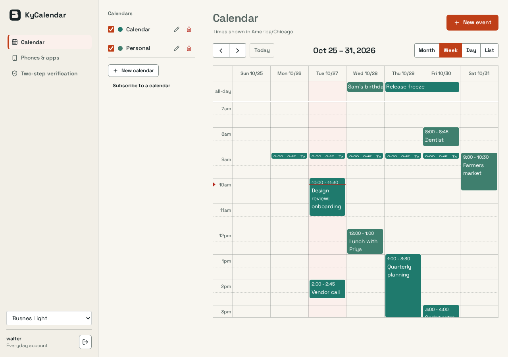 | 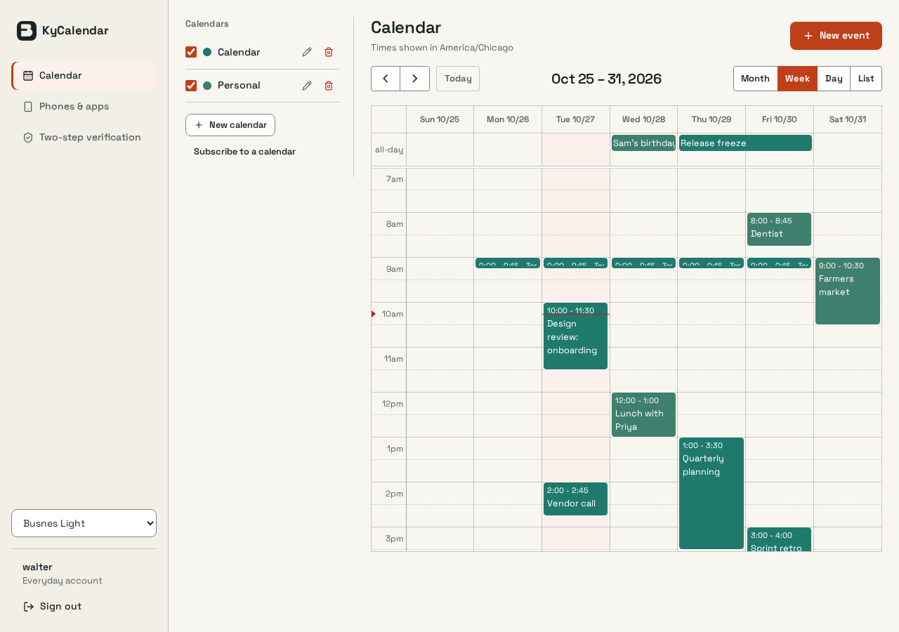 |
| 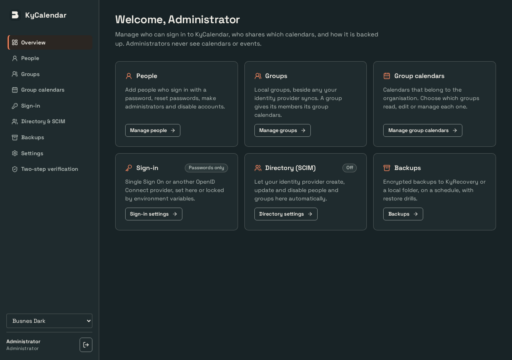 | 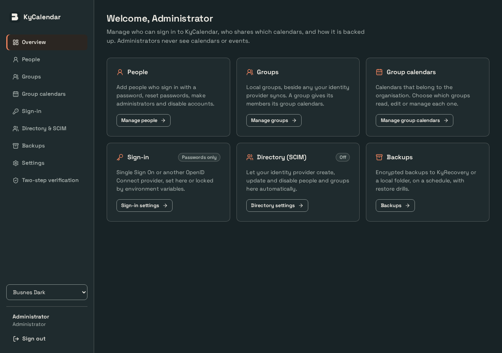 |
| 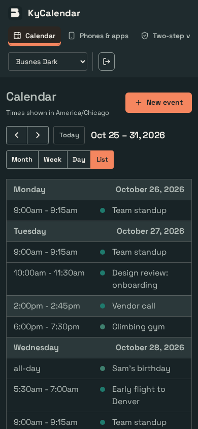 | 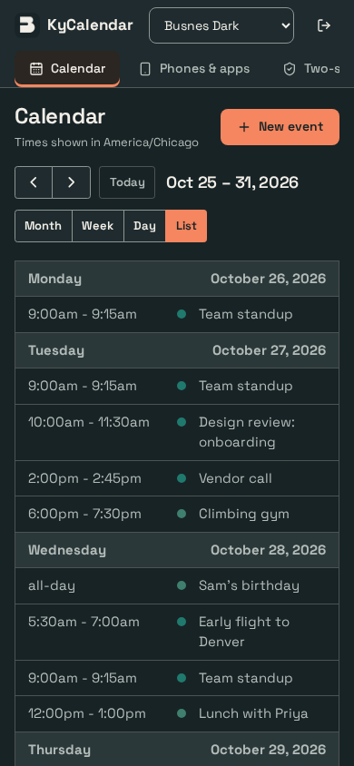 |

Full batch: `kycalendar-01-{before,after}-{calendar,admin-overview}-{desktop,mobile}-{light,dark}.png`.

Checks: `npm test` 22 files / 153 tests passed; production build passed; overflow 0px on all
8 after captures.

Open: the wordmark and stamp icon size (28px icon, 17px wordmark) is not yet fixed across
products by the contract; KyPost uses 48px/1.35rem.

## Stage 2: task views

Source: before = stage-1 after (`e2d28a9d…e77e1`), after `04792b88…9e2bc`.

Changes (`calendar.css`, `CalendarPage.tsx`, `ui.css`):

- Named themes: `calendar.css` read `--ky-*` directly, which stay Busnes Light under the saved
  named palettes, so under Nord the calendar names, date title and toolbar rendered dark on
  dark and today was a cream column (`kycalendar-02-before-named-week-*-nord.png`, a
  pre-existing defect). It now reads the product aliases every palette defines, as the
  rest of the app does (`kycalendar-02-after-named-week-*-nord.png`).
- One filled orange control per view: FullCalendar's buttons are neutral 40px/8px controls;
  the selected view is a surface change plus a 3px accent rail, not a second filled orange
  button. FullCalendar's own focus shadow, which stayed after a click, is replaced by the
  shared 2px ring on keyboard focus only.
- Today: a neutral column tint, the header in accent with an accent rail (was an
  orange-tinted column).
- Week/day headers: weekday over a 17px date ("Tue / 27"); the toolbar title carries the month.
- Working-day density without hiding the night: slots 28px (56px an hour) and the time grid
  fills the window below the heading (`calc(100vh - 7.5rem)`), so 1280×900 shows 07:00 to
  about 17:45 (was 07:00–15:00 with 100px unused). `scrollTime` 07:00 and the full
  00:00–24:00 range are unchanged: the 05:30 flight and 22:00 deploy window stay a scroll away
  and appear in Month and List.
- Event legibility: titles 600, times 400, 13px; events shorter than 30px show the title
  only, at least 20px tall (was "9:00 - 9:15 Te").
- Calendar list: section heading 17px, rows and row tools 40px; delete stays ink until hover
  or focus (confirm unchanged). Admin Overview tile icons are ink, not orange.

Inspect/fix/confirm: the first after capture lost the selected view's rail while the
clicked button kept focus, and the mobile week headers ran together ("Sun 25Mon 26");
fixed together and recaptured. That confirm capture exposed a regression from this stage
(List day headers lost their date, because the custom header renderer applied to every
view); it was scoped to the time-grid views and the batch recaptured a second time.

| Before | After |
|---|---|
|  |  |
| 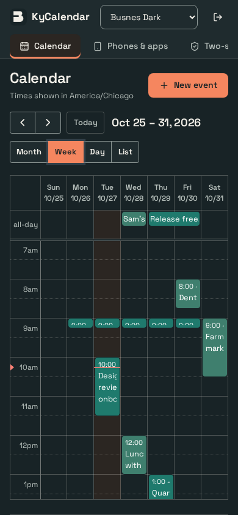 | 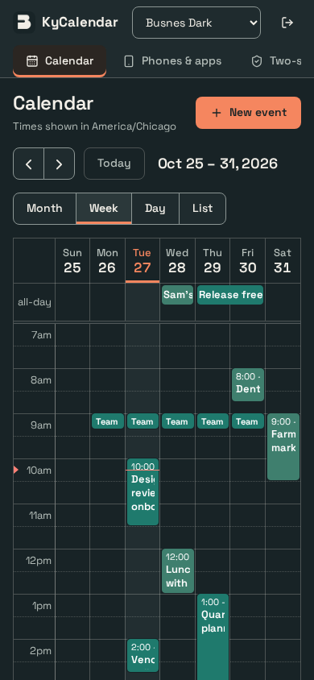 |
| 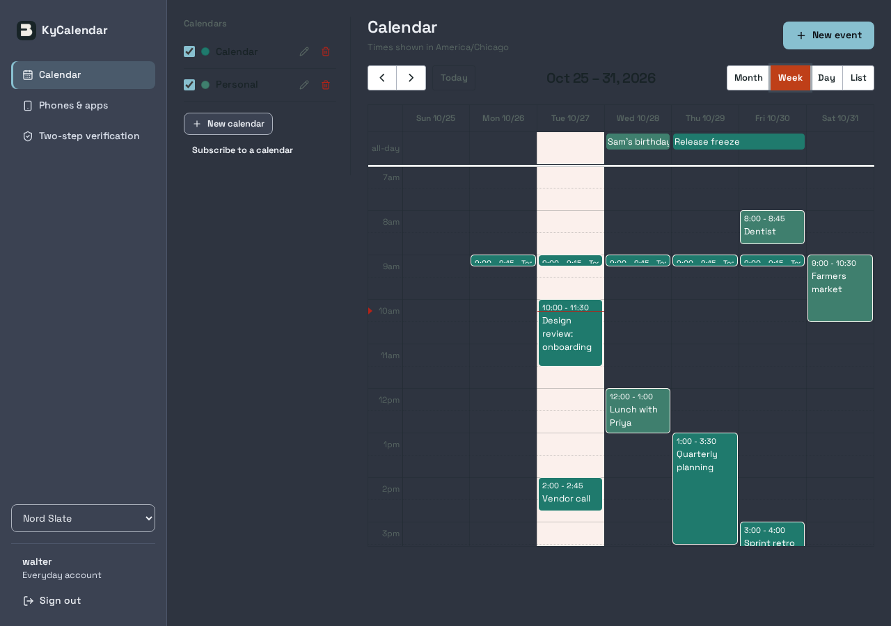 | 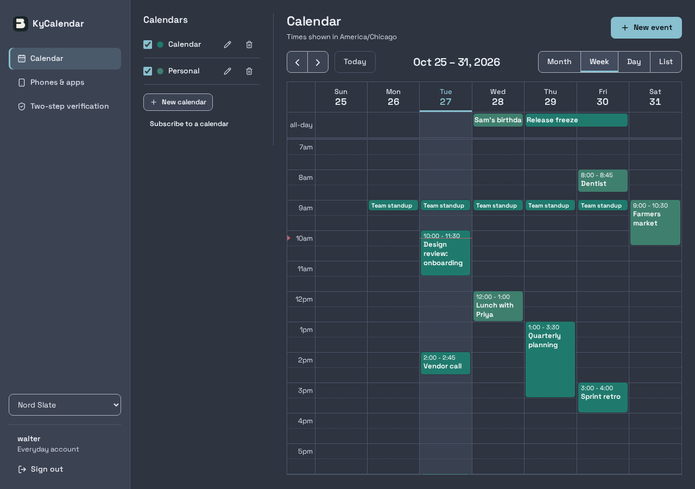 |

Full batch: `kycalendar-02-{before,after}-{week,month,list,admin-overview}-{desktop,mobile}-{light,dark}.png`,
plus `kycalendar-02-{before,after}-named-week-{desktop,mobile}-nord.png`.

Checks: `npm test` 22 files / 153 tests passed; production build passed; overflow 0px on
all 18 after captures.

Open: mobile week and month remain cramped at 390px (seven columns); List stays the narrow
default, unchanged.

## Stage 3: forms and dialogs

Source: before = stage-2 after (`04792b88…9e2bc`), after `694ff5b1…cba81`.

Changes (`theme.css`, `ui.css`, `calendar.css`, `EventDialog.tsx`):

- Event dialog: the scope choice ("Change: This event / All events") and the weekday picker
  are titled groups, not boxed fieldsets. Label to field 8px, field to next label 16px.
  Labels 13px/600; Location and Description say "(optional)" in text. The action footer is
  unchanged in order and kind: Delete (danger outline, set apart on the left), Cancel
  (secondary), Save (the one primary, right). Dialog title 20px.
- Shared fields: 15px text; keyboard focus is one 2px accent ring at a 2px offset (was the
  accent border plus a 1px-offset ring). Checkbox rows are 40px tall.
- `.btn-sm` keeps its smaller text and padding but no longer drops below the 40px target;
  the compact admin select likewise.
- Settings forms (`.form`): fieldsets are titled groups without a border (Phones & apps
  "Kind"); hints and choice hints 13px.
- Calendar sidebar edit, new-calendar and subscription forms sit on the sidebar surface
  under a divider instead of a nested box.

Inspect/fix/confirm: the first after capture showed the End datetime field 2px past the
form edge at 15px text and loose spacing between All day and Start on phones; fixed
together and recaptured once.

| Before | After |
|---|---|
| 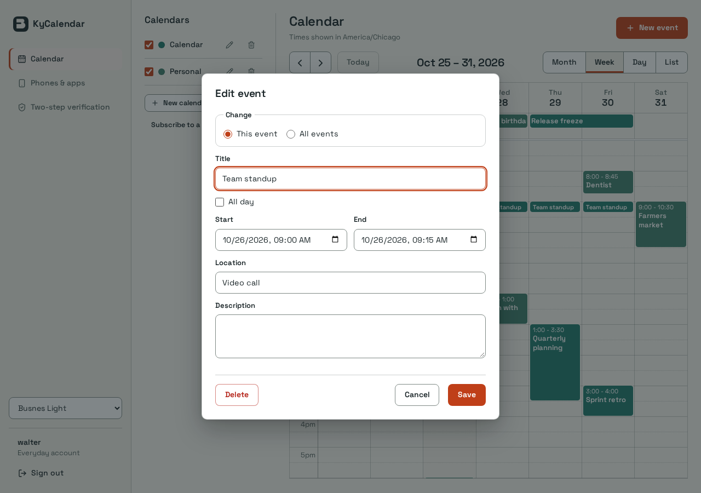 | 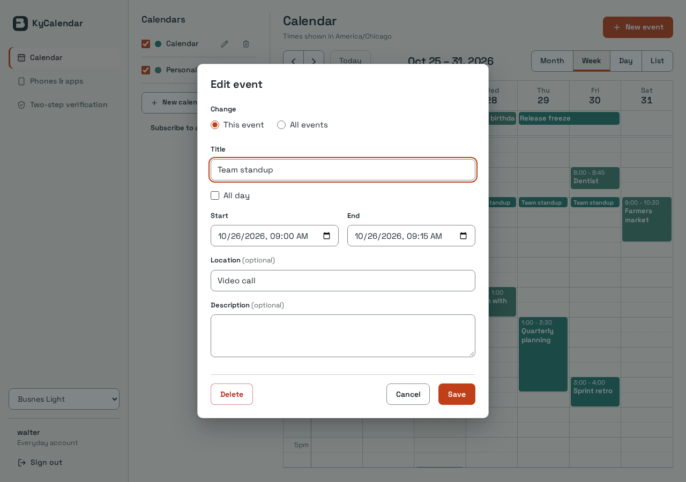 |
| 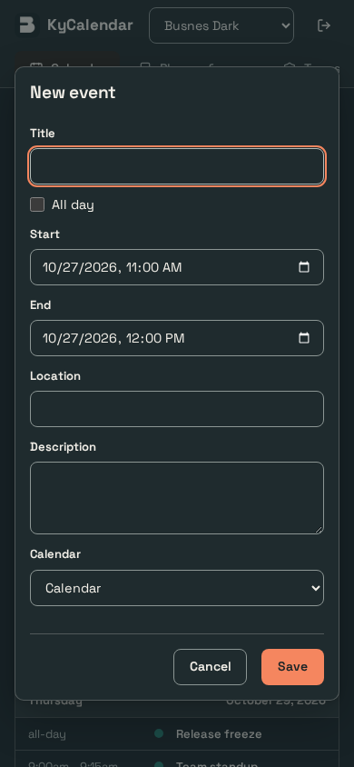 | 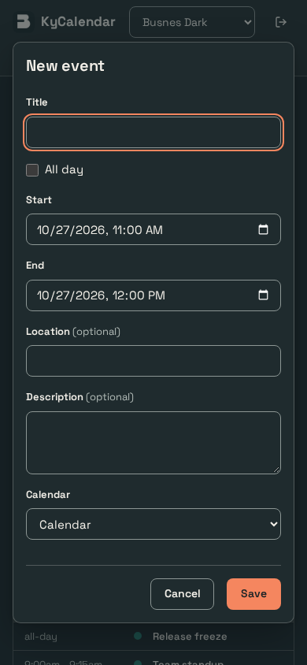 |
| 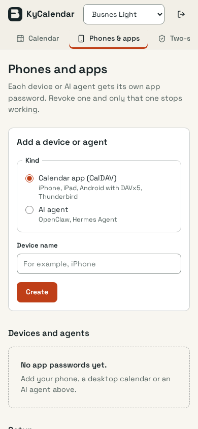 | 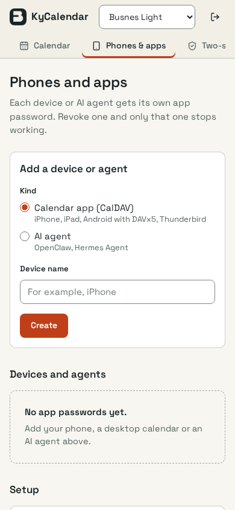 |

Full batch: `kycalendar-03-{before,after}-{new-event,edit-recurring,settings,devices}-{desktop,mobile}-{light,dark}.png`.

Observed, not changed (needs a product decision): the New event dialog offers no Repeat
field. `EventDialog` starts a new event with scope `this`, and Repeat renders only for
scope `all`, so a repeating event can be created only on a device or by editing it later
(`EventDialog.tsx`, `useState(choose || !event ? 'this' : 'all')`). Changing it adds a
feature path, so it was left for the owner.

## Post-stage-3 gate fixes (not recaptured)

The gate run below found three small defects after the stage-3 confirm capture. Fixed in
CSS; they change no captured state, so stage 3 was not recaptured:

- FullCalendar prev/next buttons were 39px wide; now at least 40px.
- `datetime-local`/`date` fields focus an inner segment, which `:focus-visible` does not
  report on the input, so Tab into Start/End drew no ring. They now draw the ring on
  `:focus`.
- The calendar-visibility label (the checkbox's target) is now 40px tall.

Source after these fixes: `511b756d…f91aee` (= stage-4 before).

## Stage 4: one left column (user steering)

The user rejected the two adjacent left panels (app sidebar + calendar list column). This
stage removes that composition.

Source: before `511b756d…f91aee`, after `bb0f4a43…3892a`.

Changes (`App.tsx`, `AppHeader.tsx`, `CalendarPage.tsx`, `calendar.css`, `theme.css`, tests):

- The app sidebar has a slot between navigation and the account region
  (`.app-sidebar-slot`, scrolls on its own). Above 720px `CalendarPage` renders
  `CalendarSidebar` into it with `createPortal`; the calendar page is a single column and the
  canvas takes the full content width (week day columns ~134px, were ~96px at 1280).
- At 720px or less the list follows the canvas inline, as before; List stays the narrow
  default. Crossing the breakpoint moves the list (`matchMedia` change listener).
- In the sidebar the list reads as a navigation group: 14px heading, rows aligned with the
  navigation icons, no row dividers; on pointer screens Edit/Delete appear over the row end
  on hover or keyboard focus (still in the Tab order, still named "Edit <name>" /
  "Delete <name>"); touch screens show them always.
- Every calendar control is unchanged in behaviour: visibility toggles (same storage key),
  new calendar, rename/recolour, delete with confirm, subscribe, refresh and change link,
  role-based visibility of tools.
- New tests: `CalendarPage.test.tsx` "puts the calendar list in the given app sidebar slot,
  else after the canvas"; `browser/calendar.spec.mjs` asserts the list is in the app sidebar
  at 1280px and after the canvas at 390px, in both themes.
- Contract recorded in `web/AGENTS.md`: one left column, never two adjacent left panels.

Inspect/fix/confirm: the first after capture showed the sidebar's New calendar / Subscribe
actions wrapping side by side; stacked them left-aligned and recaptured once. Remaining:
the ghost "Subscribe to a calendar" text sits 16px in from the heading (button padding); a
long subscription form scrolls inside the sidebar slot without a visible scroll cue.

| Rejected: two left panels | One left column |
|---|---|
| 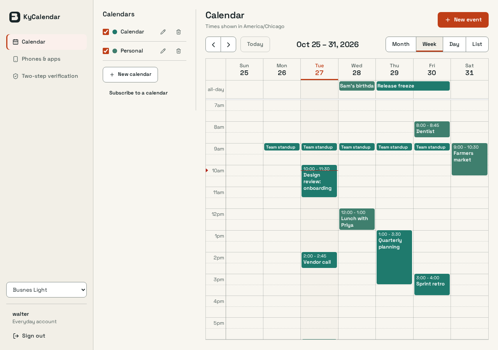 |  |
| 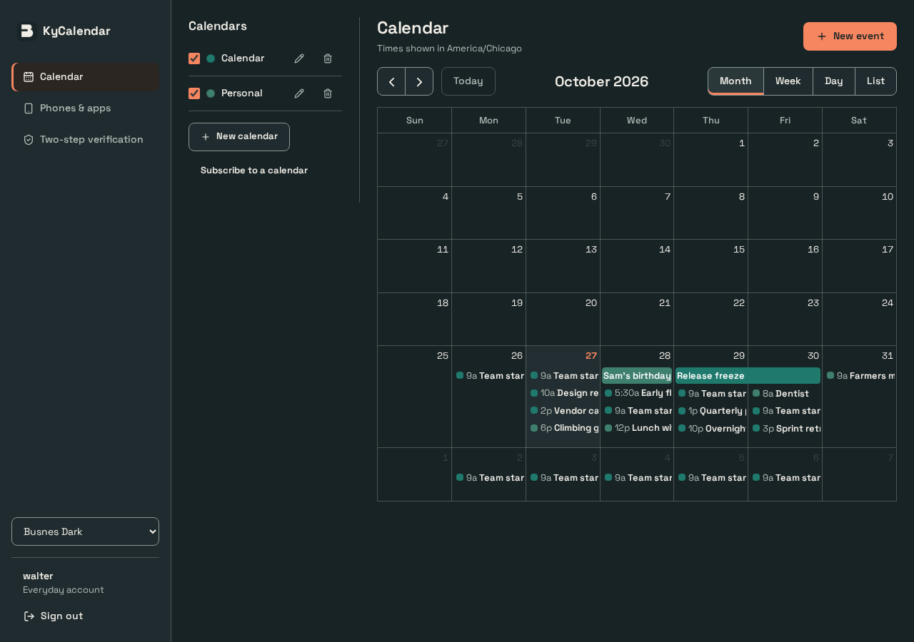 | 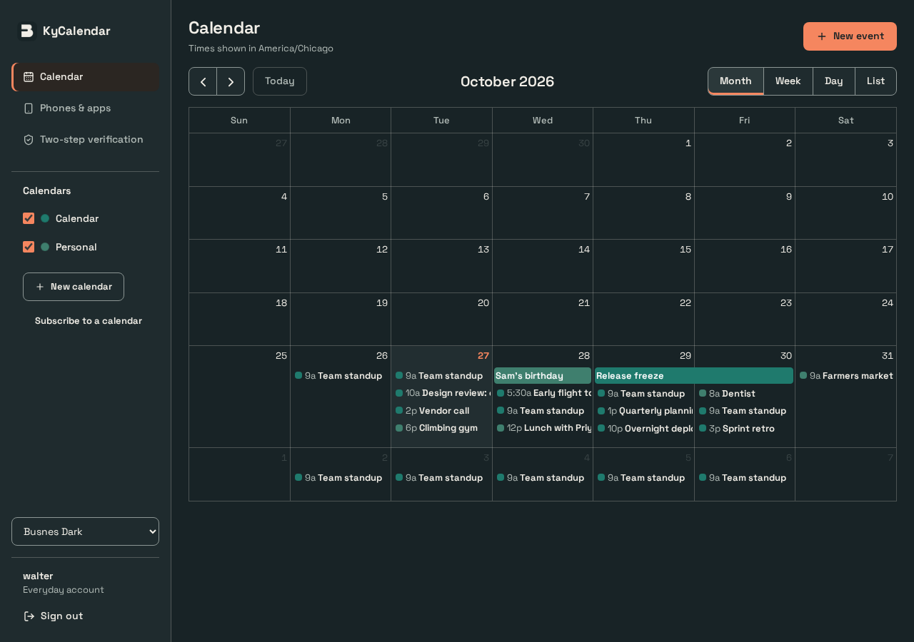 |
| 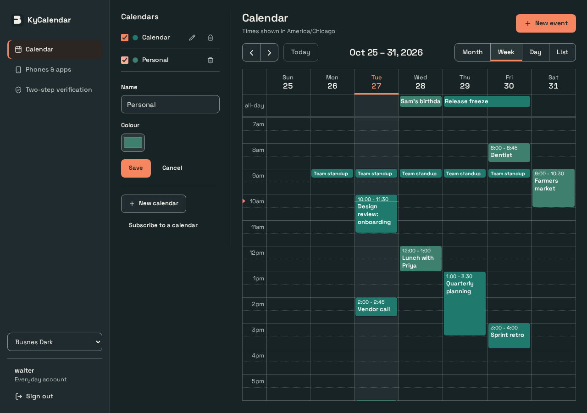 | 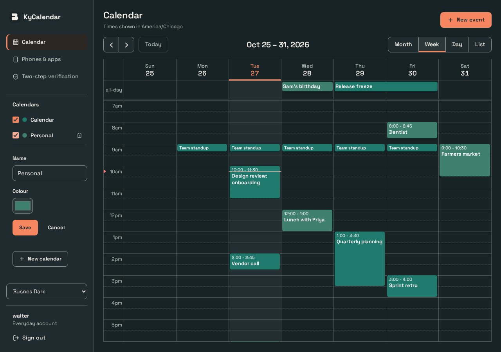 |
| 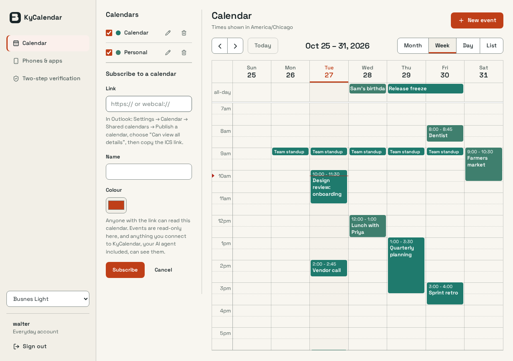 | 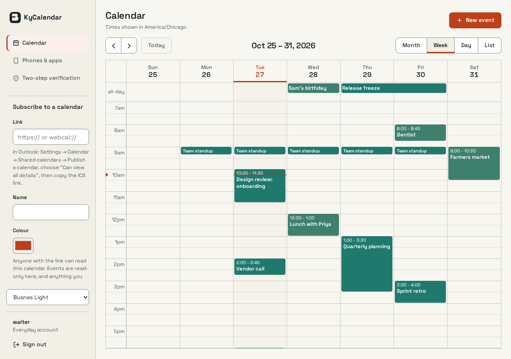 |
| 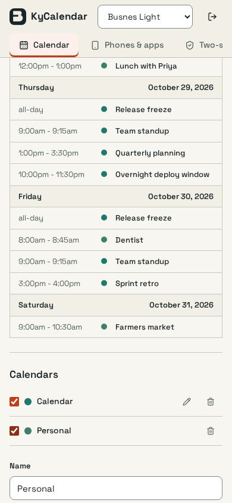 | 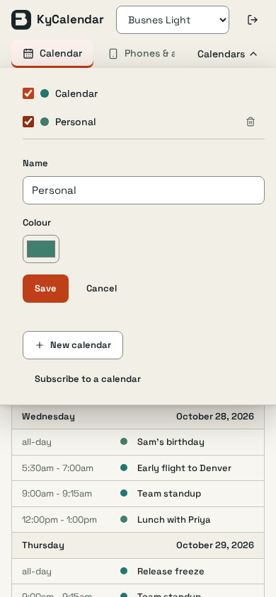 |

Full batch: `kycalendar-04-{before,after}-{calendar,month,calendar-edit,subscribe}-{desktop,mobile}-{light,dark}.png`.
### Stage 4 fix: one mounted list at every width

Regression in the first stage-4 source (`stage-04-after-v1.src.patch`, `11d8d2d8…65f11`):
`CalendarPage` portalled the list into the sidebar above 720px and rendered it inline below,
so crossing the breakpoint changed the portal parent and React unmounted `CalendarSidebar`,
discarding half-filled add, rename, subscribe and change-link forms. Reproduced before the
fix by the new browser test (light-1280): after resizing to 390px the list was a new node
outside the shell (`{inShell: false, probe: undefined}`, expected `{inShell: true, probe:
"same node"}`); log `/tmp/ky-ui-council-kycalendar/resize-prefix.log`.

Fix (`CalendarPage.tsx`, `theme.css`, `calendar.css`, tests, docs), source
`stage-04-after.src.patch` `62da0101…8b3b9`:

- The list always renders through the portal into `.app-sidebar-slot`, at every width; the
  portal target never changes, so the same `CalendarSidebar` DOM and state stay mounted. No
  business state lifted, no duplicated controls, no second left panel.
- It sits in a native `
`: above 720px it is forced open and its
  summary hidden (desktop unchanged: the list stays in the one primary sidebar). At 720px or
  less the summary is a "Calendars" disclosure at the end of the header's navigation row, in
  its own grid column so the navigation keeps its width; closed at first (List stays the
  narrow default, the canvas leads), its panel drops over the page and scrolls inside itself.
- Keyboard: Enter/Space on the summary toggles it; Escape inside closes it and returns focus to
  the summary. Focusing anything in the list keeps the disclosure open, so a form in use stays
  visible when a window or phone rotation narrows past 720px.
- Phone Tab order: navigation → Calendars → theme → Sign out → New event → toolbar; closed
  panel content is not in the Tab order.
- Tests: `CalendarPage.test.tsx` "keeps the same calendar list and its drafts across the phone
  breakpoint" (stubbed media query: same `aside` node and input nodes, drafts kept, disclosure
  closes, reopens, Escape returns focus); `browser/resize.spec.mjs` in all four projects
  (starts at the project's width, crosses to the other and back: same node by a DOM probe,
  rename and subscribe drafts visible, Escape/Enter on the disclosure, an add-calendar draft,
  no horizontal overflow). `calendar.spec.mjs` and `groups.spec.mjs` open the disclosure at
  390px.

Inspect/fix/confirm: the first after capture showed the phone summary sharing the account
controls' grid column (about 210px), which squeezed the navigation to "Calendar" alone; gave
the summary its own column and recaptured once.

| Before (stage-4 v1 / stage-4 before) | After |
|---|---|
| 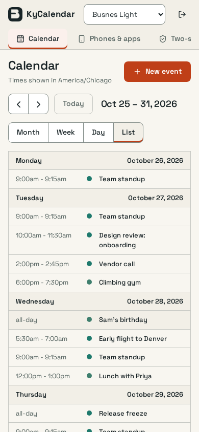 | 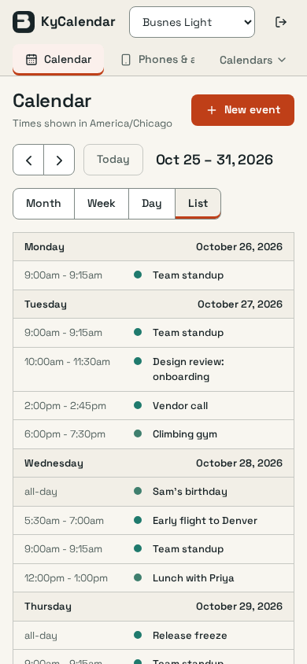 |
| (no phone disclosure before) | 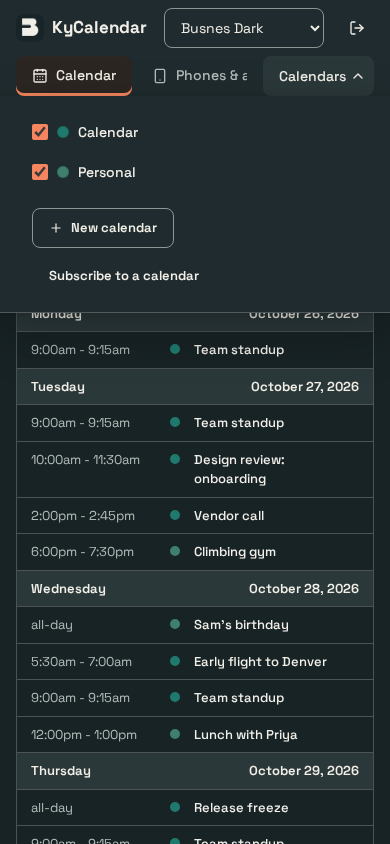 |
| 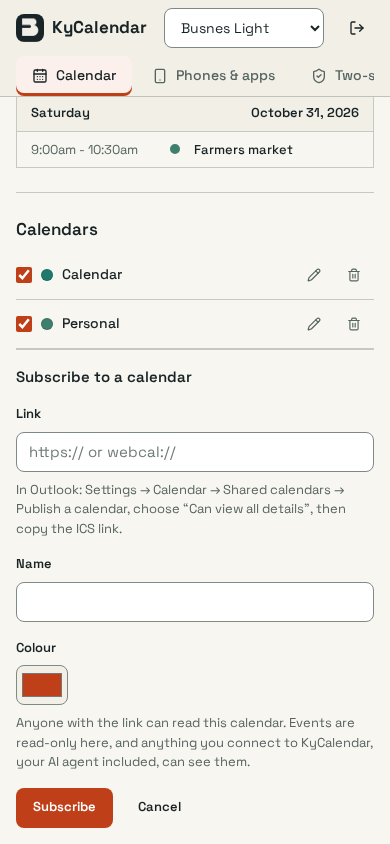 | 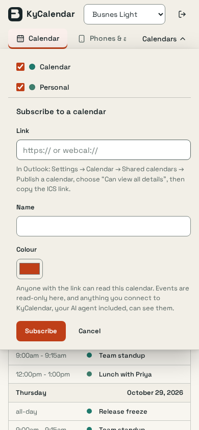 |

Draft survival, captured on the final build (rename "Personal (draft)", subscription link and
name typed, then the window resized):

| Typed | Crossed 720px | Back |
|---|---|---|
|  | 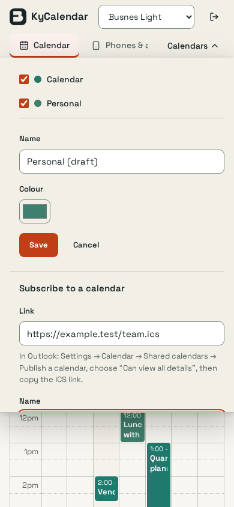 | 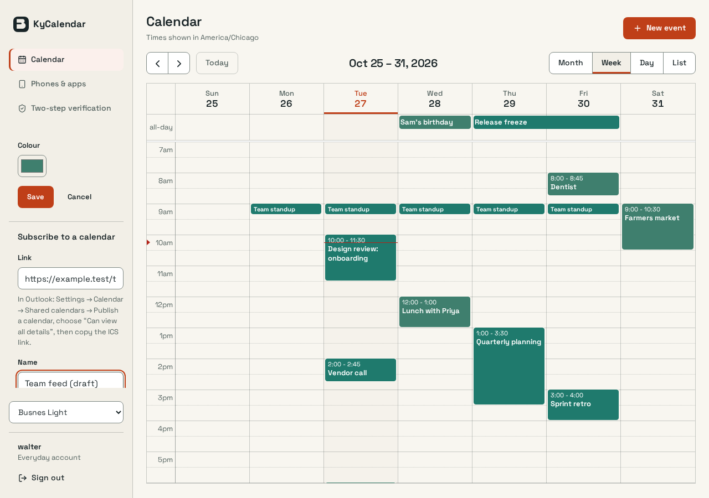 |
|  | 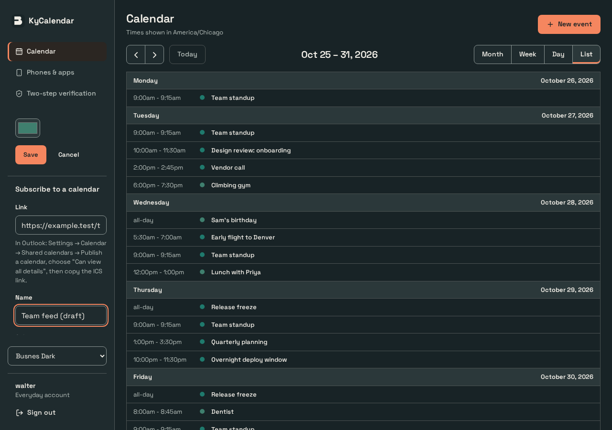 | 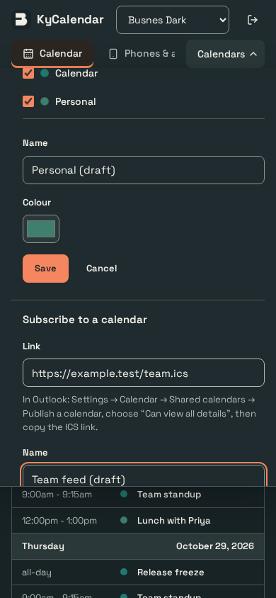 |

The stage-4 after batch was recaptured on the final build (dist `040f6752…3fb08`, server
`e901d0bf…6d00`): `kycalendar-04-after-{calendar,calendars-open,month,calendar-edit,subscribe}-{desktop,mobile}-{light,dark}.png`
and `kycalendar-04-after-draft-resize-{desktop,mobile}-{light,dark}-{1-typed,2-crossed,3-back}.png`
(32 files, 0px overflow, manifest `kycalendar-04-after-manifest.json`). The before frames
(`kycalendar-04-before-*`) are unchanged. No before frames exist for `calendars-open` and
`draft-resize`: the v1 build was not kept, and the failing test log is the before evidence.

Changing behaviour on phones: the list is no longer below the canvas; it is behind the header
disclosure (accepted user preference for phones).

## Stage 6: final-review corrections

Responds to `implemented-calendar-final-review.md` (findings 1–5 and the easy parts of 6). Base
for every patch is `9a527d2`; HEAD is now the parent's `4cacdb7` (stage 1–4 committed) plus the
parent's final ky-ui 0.3.0 selected-hover sync (`navigation.css`, `VERSION`; kept, unedited).

Sources (all `git diff 9a527d2 -- web/src web/browser`, untracked files included):

| State | Patch | SHA-256 | Build |
|---|---|---|---|
| before (HEAD + hover sync) | `stage-06-before.src.patch` | `b8631637…5709b0` | dist `49296d94…8680`, server `1f71b438…ffae` |
| after (final) | `stage-06-after.src.patch` | `2d1d4822…e0d0` | dist `84fe0ddf…fc4f`, server `5eb784cf…83bb` |

Product diff without `web/dist`: `stage-06-final.product.patch` `b0beb460…fc3b` (21 files). All
three apply cleanly to `9a527d2`. The after captures and gates ran on dist `84fe0ddf…` and server
`5eb784cf…`. A final rebuild of the final source reproduced both byte for byte; the source edits
made after the capture (one test timeout, a test annotation, docs) do not reach the dist.
Drivers: `capture-06.mjs.txt`, `gates-06.mjs.txt`, `build06.sh.txt`. Manifests:
`kycalendar-06-{before,after,confirm1}-manifest.json`.

Changes:

1. **Out-of-month days (contrast).** FullCalendar's `.fc-day-other .fc-daygrid-day-top {opacity:.3}`
   is reset to 1. Product's own `.7` removed; the number is muted by colour alone (`--ink`).
   Composited contrast measured in the browser suite (opacity chain multiplied, blended on the
   first opaque background): **5.73:1 light, 8.26:1 dark** at 390 and 1280. The reviewer's
   pixel estimate before was ~1.35 / ~1.57.
2. **Phone Month.** At 720px or less each event shows its dot (timed) or bar (all-day) and start
   time ("9a", "5:30a"). The title is visually hidden, not removed. Grid events get
   `role="button"` (`eventDidMount`; FullCalendar renders them as focusable `<a>` without href),
   so time and title are the accessible name in every grid view. Click, Enter and Space open the
   same form. List keeps full titles.
3. **Desktop Subscribe.** Opening the subscribe or change-link form moves focus to its Link field
   (its trigger disappears, which used to drop focus to `<body>`). It also scrolls the form into
   view from its heading. Rename now takes focus too (`autoFocus`). The wide sidebar slot fades
   whichever edge hides content (`AppHeader` `useScrollCue` sets `data-cue`; CSS mask), with
   `scroll-padding` so focused fields clear the fade.
4. **Phone navigation.** The same cue fades the end of the horizontally scrolling navigation
   ("Phones &" fades out instead of a hard cut). Controls, order and names are unchanged.
5. **Subscribe button.** It is now an outlined button matching "New calendar" (Rss icon). Its
   visible text is "Subscribe" so it fits the 240px sidebar on one line; the accessible name stays
   "Subscribe to a calendar" (label in name).
6. **Minor.** Month titles end in an ellipsis. The open phone disclosure has a 1px
   `--line-strong` ring, so the open state shows in light too.
7. **States (honesty).** While events load, the heading says "Loading events…" (`role="status"`)
   and an empty list says "Loading events…" instead of "No events to display". After a failed
   load the list says "Events could not be loaded." beside the existing alert. The heading's title
   column now wraps in place, so New event keeps its row.

Not changed: two filled primaries in desktop calendar edit (form-scoped, as the review accepts);
the accent-like default subscription swatch (palette logic); required/optional marks on the
subscribe fields (unmarked = required, matching the event form, where optional fields say so);
Repeat (out of scope).

Tests: `browser/month.spec.mjs` × 4 (new): contrast ≥ 4.5 with the value recorded as an
annotation; the event is a button named with its title and opens the same form; offline alert
plus "Events could not be loaded.". `resize.spec.mjs` still passes. The unit breakpoint test now
asserts focus inside the opened form keeps the disclosure open. `App.test.tsx`'s lazy-chunk wait
was raised to 5s after one failure in four runs on a host at load average 31 (other actors
building), with "Loading calendar…" still showing. That test is unrelated to this change and was
not edited by it before.

Inspect/fix/confirm. The before frames were inspected together (contact sheets). They showed
findings 1–5, plus two state defects the review could not see: "No events to display" while
loading, and next to the offline alert. Everything was fixed in one batch. The confirm capture
(kept as `kycalendar-06-confirm1-*`) showed two regressions from this batch: the outlined
Subscribe label wrapped to two lines in the desktop sidebar, and "· Loading events…" pushed New
event to its own row on phones. Both were fixed and the after set was recaptured once
(`kycalendar-06-after-*`). The capture driver no longer scrolls the opened Subscribe form itself,
so the frames show where the product leaves it.

Captures: `kycalendar-06-{before,after}-{month,subscribe,calendar,calendars-open,new-event,empty,loading,error}-{desktop,mobile}-{light,dark}.png`.
That is 32 before and 32 after, all with 0px horizontal overflow, and the final New event dialog
appears in all four combinations. States are captured from the real server: empty is the week
before the seeded series; loading holds the request with 3s of emulated network latency (CDP,
`route` not used); offline is the browser context set offline. No response body is faked and no
auth is bypassed.

| Before | After |
|---|---|
| 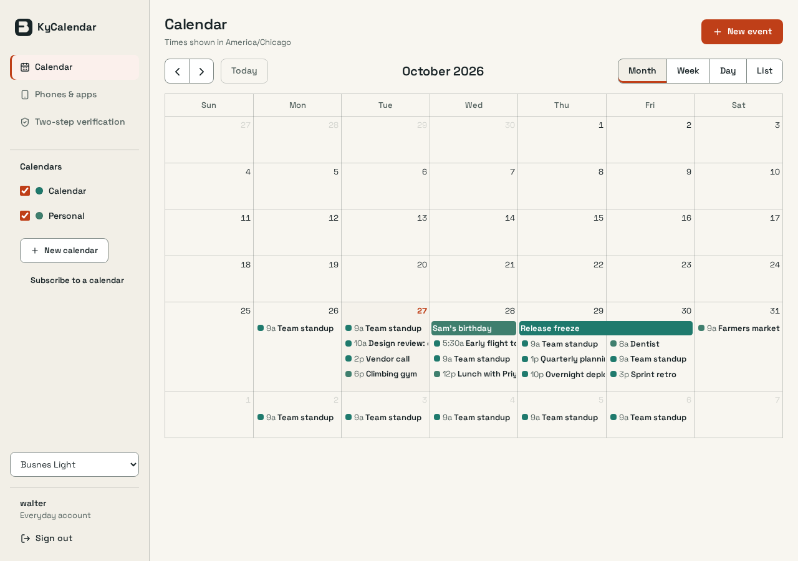 | 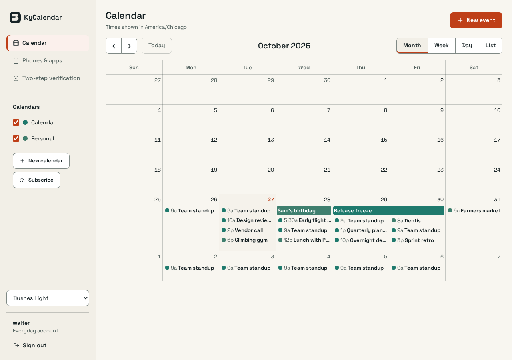 |
| 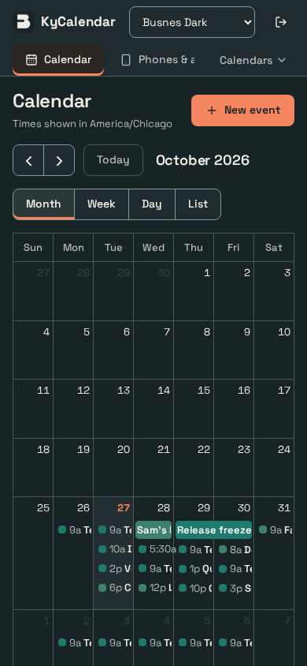 | 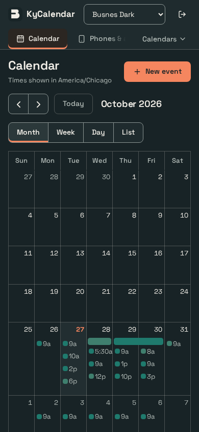 |
| 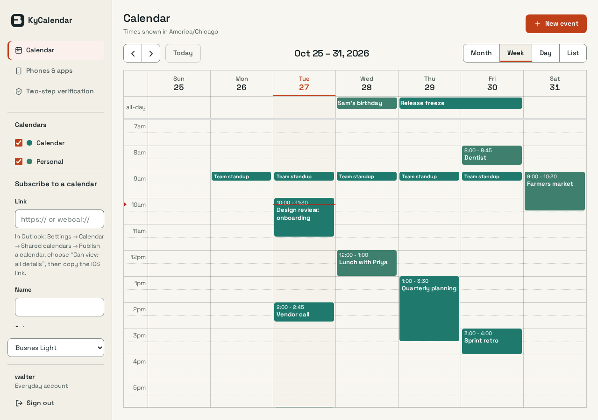 | 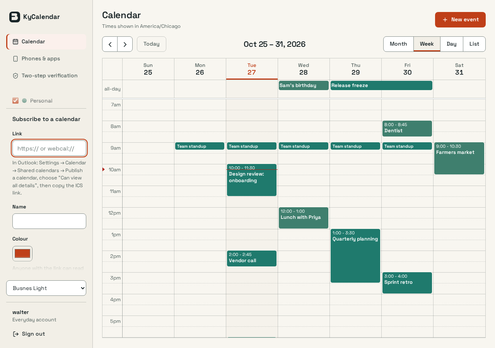 |
| 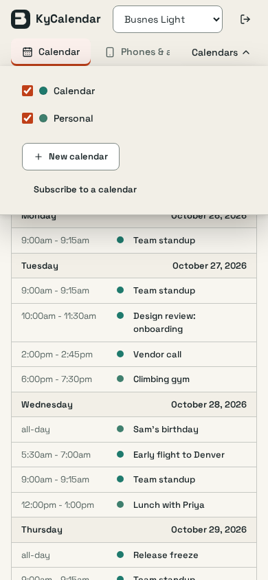 | 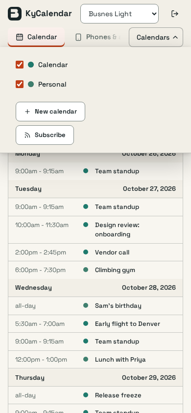 |
| 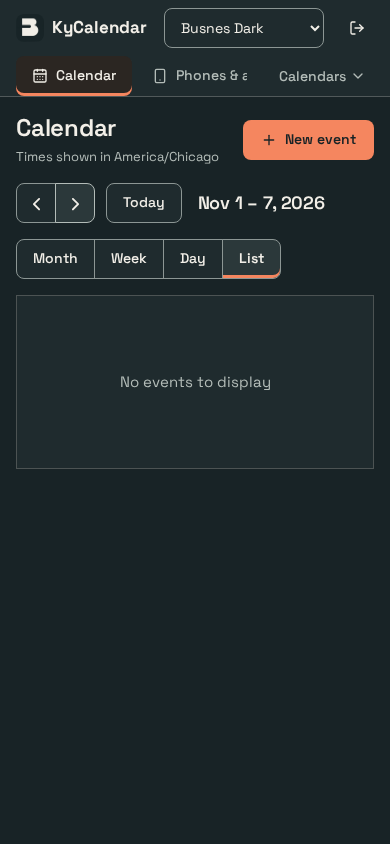 | 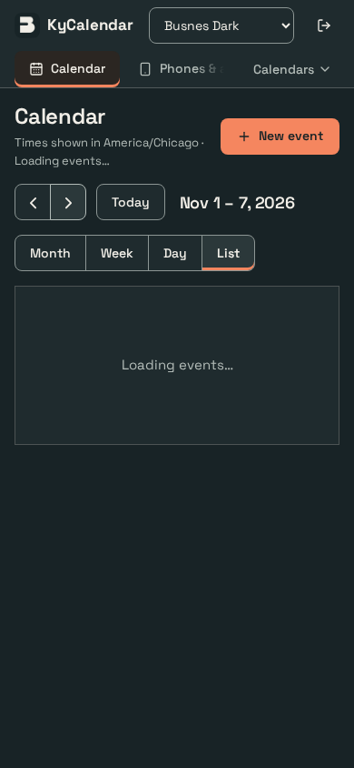 |
| 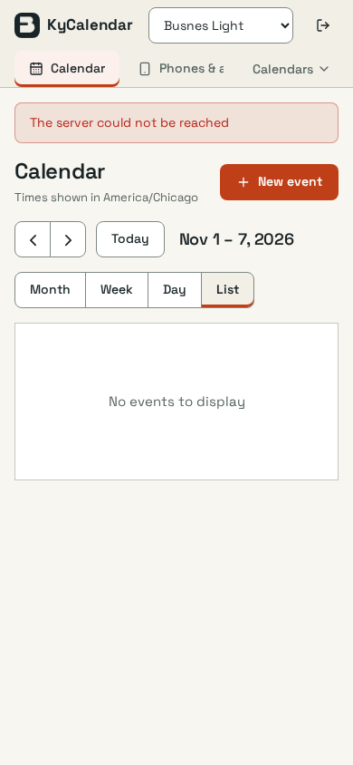 | 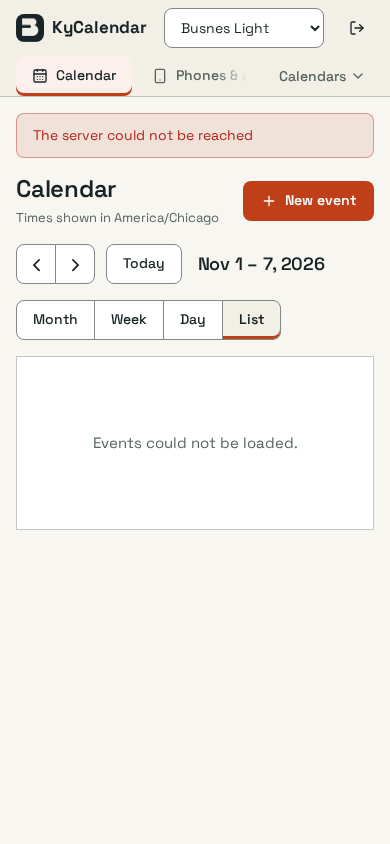 |
| 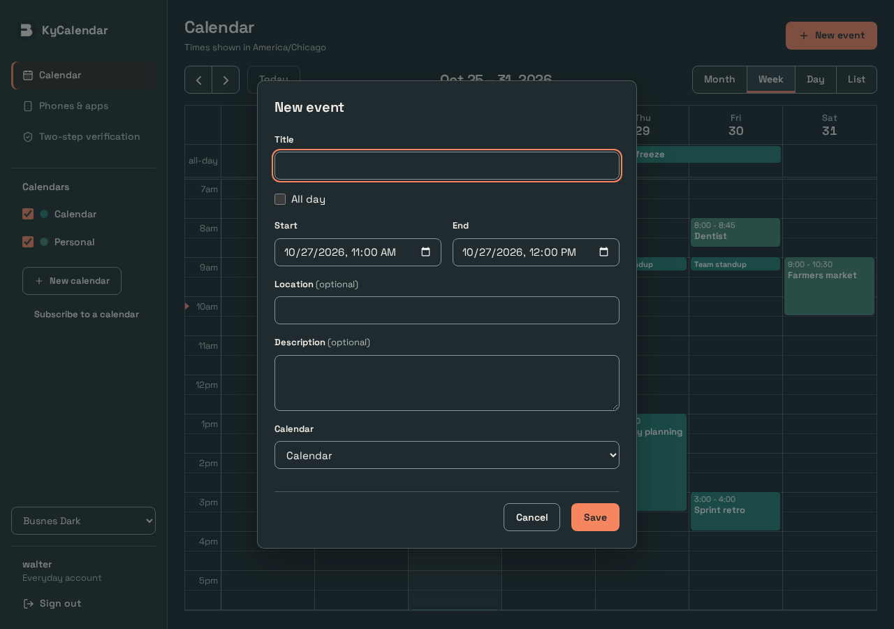 | 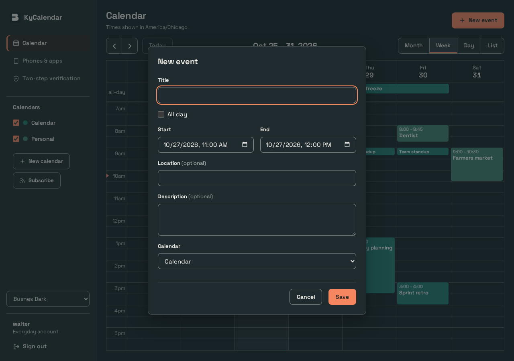 |

Checks on the final source:

| Check | Result |
|---|---|
| `make ci` | passed; frontend 22 files / 155 tests, Go race/vet/tidy, fork tests, smoke |
| unit suite repeated | 155/155 three times in a row after the timeout change |
| `npm run build` (typecheck, vendor hash) | passed; dist identical to the captured build; `check-vendor.mjs` passes |
| `npm run test:browser` | 28 passed (24 before plus `month.spec.mjs` × 4) |
| gates (`gates-06.mjs.txt`, `screenshots/kycalendar-06-gates.json`) | 39 page stops, 0 without a ring; dialog stops all ringed; `date_focus_unverified` empty; 19–22 contrast pairs per run, min 3.36 (non-text border, needs 3), no failures; 0px overflow; focus returns to New event |
| `make test-postgres`, Docker build | not run (no Postgres here; Docker is a CI job) |

Remaining gaps:
- At 1280×900 the open Subscribe form is taller than the sidebar slot. Its heading and Link field
  show and the bottom edge fades, but Subscribe/Cancel still need a scroll of the slot.
- `states` is now captured (empty, loading, offline) but has no rubric score yet. A server-side
  error other than offline (e.g. 500) was not produced; that would need a fault the real server
  does not expose.
- Named palettes (Nord etc.) were not recaptured; only their persistence is gated.
- Real phones, Safari and Firefox untested: mask-image fades, `:has()` and `
` behaviour
  were checked in Chromium only.
- No scores: this record carries none.

## Final source (stage 4; Stage 6 above supersedes it)

- HEAD `9a527d2`, uncommitted. Source state `web/src` + `web/browser` including the untracked
  `web/browser/resize.spec.mjs`: `source-stages/kycalendar/stage-04-after.src.patch` SHA-256
  `62da0101e183ac9790d7193ac1d55dbaef12748b5e1b0f24bb5e6b5214e8b3b9`; whole product diff
  excluding `web/dist`: `final.product.patch`
  `beae9fa5e16896e856b6f7dcd98d6f63c52110d825aa98303ba9d79413317114` (17 files). Both apply
  cleanly to `9a527d2` (`git apply --check`). Vendored `web/src/ky-ui` is the parent's 0.3.0
  sync, unedited here (`check-vendor.mjs` passes).
- `web/dist` rebuilt from that source (tree hash `040f6752…3fb08`, reproduced byte for byte by
  a second build); `.browser/server` SHA-256 `e901d0bf…6d00`. Captures and gates ran on this
  dist and binary.

## Checks on the stage-4 source

| Check | Result |
|---|---|
| `make ci` (tidy-check, gofmt + vet, `go test -race` with coverage, vendored go-webdav tests, `npm ci && npm test`, smoke) | passed; frontend 22 files / 155 tests (code unchanged since; only docs edited after) |
| `npm run build` (includes typecheck and vendor hash check) | passed; dist identical to the captured build |
| `npm run test:browser` (Chromium, light/dark × 390/1280, port 5391) | 24 passed (the 20 before plus `resize.spec.mjs` × 4) |
| `make test-postgres` | not run: no PostgreSQL instance here |
| Docker image build / container check | not run locally (CI job) |
| Gate script `/tmp/ky-ui-council-kycalendar/gates.mjs` | ran; results in `screenshots/kycalendar-gates.json` |

## Behaviour gates (rubric `ky-suite-v2`), stage-4 source

| Gate | Result | Evidence |
|---|---|---|
| `keyboard` | pass for the paths walked | Tab walk from page top in both themes and sizes: navigation → calendar list (desktop) or the Calendars disclosure (phone) → theme → Sign out → New event → toolbar; Escape in the open phone disclosure closes it with focus on its summary (`resize.spec.mjs`); Enter on New event opens the dialog with focus on Title; Tab stays in the modal (wraps through browser chrome, page inert); Escape closes and focus returns to New event. Browser suite: Enter on a list event, Escape, nav Tab order. Drag-and-drop has no keyboard equivalent (pre-existing; the event form covers the same edits). |
| `focus` | pass for the paths walked | Every page stop and every dialog control shows a visible focus indicator. Accounting corrected in `gates.mjs`: a Tab that lands on `<body>` is the browser-chrome wrap, not a page stop (one per walk, no longer counted as a missing ring). Date fields are checked against an unfocused crop taken once the dialog has stopped fading in: with a date segment focused the field root draws the 2px accent ring outside its box (computed outline and 1157–1499 changed pixels in the band outside the box); with the calendar-picker icon focused (inside the UA shadow, so the input is not `:focus`) Chromium draws its own high-contrast box around the icon (136 changed pixels over the icon, 0 outside the box), black on light and white on dark. That native indicator is accepted as valid focus; the native input is kept. `date_focus_unverified` is empty in all four runs. Enlarged crops: `screenshots/kycalendar-04-after-focus-date-fields.png` (rows: unfocused, field root, picker icon; light left, dark right). |
| `contrast` | pass for 19–22 measured pairs per run | Computed styles, translucency composited: minimum 3.36:1 (light FullCalendar button border, needs 3), field border 3.63 light / 4.77 dark, accent text and rails ≥ 4.64, 13px meta text ≥ 5.73, event title on calendar colour 5.17. Named palettes not measured. |
| `states` | untested | Empty, loading and error states were not captured for the calendar views. |
| `responsive` | pass | 0px horizontal overflow on every capture and gate run at 390 and 1280; phone navigation scrolls and every item is reachable; targets ≥ 40px except the 16px checkboxes, whose 40px-tall labels are the target. |

Saved theme: choosing Nord persists across reload under the existing `ky_theme` key, with
the Nord palette applied (`kycalendar-gates.json`, `named_theme`).

## Not met for 9/10

- No scores: this record carries none; a council round must score the after captures.
- `states` was untested at stage 4; Stage 6 captures empty, loading and offline, unscored.
- Open product decision: New event has no Repeat field (stage 3).
- Cross-product: wordmark/stamp size and the sidebar calendar-group pattern still need the
  other products' shells to match.
